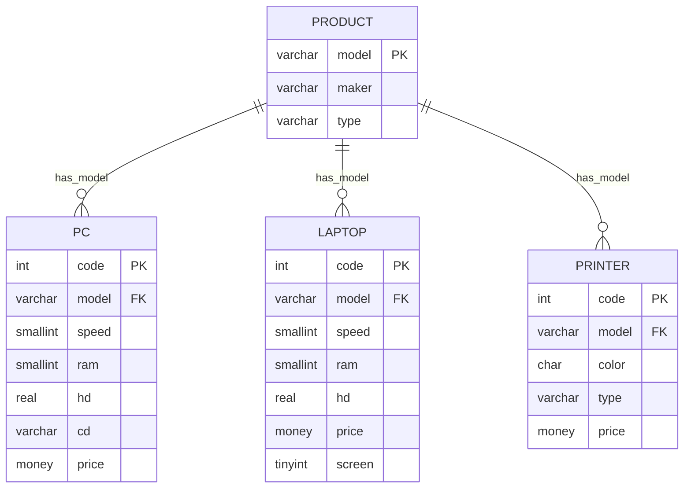
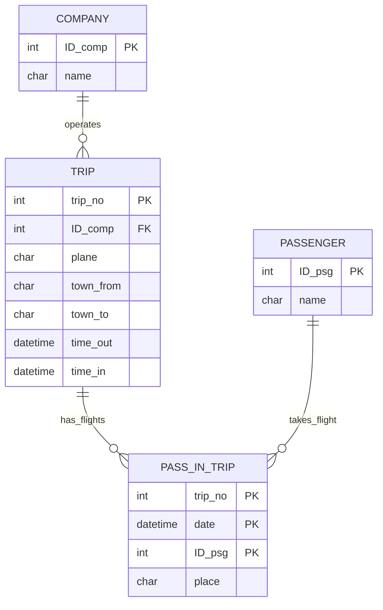

# Схемы таблиц

Ниже приведены две независимые базы из [справки SQL-EX](https://www.sql-ex.ru/help/select13.php). `PK` означает первичный ключ, `FK` — внешний ключ. Типы и длины взяты с изображений схем на странице.

## Компьютерная фирма

`Product.model` — первичный ключ и уникален для всех производителей и типов продукции. В таблицах устройств `code` — первичный ключ, а `model` — внешний ключ. `price` допускает `NULL` в `PC`, `Laptop` и `Printer`; остальные столбцы на диаграмме помечены как NOT NULL.

| Таблица   | Столбец  | Тип           | Ключ                 | NULL разрешен |
| --------- | -------- | ------------- | -------------------- | ------------- |
| `Product` | `maker`  | `varchar(10)` |                      | нет           |
| `Product` | `model`  | `varchar(50)` | PK                   | нет           |
| `Product` | `type`   | `varchar(50)` |                      | нет           |
| `PC`      | `code`   | `int`         | PK                   | нет           |
| `PC`      | `model`  | `varchar(50)` | FK → `Product.model` | нет           |
| `PC`      | `speed`  | `smallint`    |                      | нет           |
| `PC`      | `ram`    | `smallint`    |                      | нет           |
| `PC`      | `hd`     | `real`        |                      | нет           |
| `PC`      | `cd`     | `varchar(10)` |                      | нет           |
| `PC`      | `price`  | `money`       |                      | да            |
| `Laptop`  | `code`   | `int`         | PK                   | нет           |
| `Laptop`  | `model`  | `varchar(50)` | FK → `Product.model` | нет           |
| `Laptop`  | `speed`  | `smallint`    |                      | нет           |
| `Laptop`  | `ram`    | `smallint`    |                      | нет           |
| `Laptop`  | `hd`     | `real`        |                      | нет           |
| `Laptop`  | `price`  | `money`       |                      | да            |
| `Laptop`  | `screen` | `tinyint`     |                      | нет           |
| `Printer` | `code`   | `int`         | PK                   | нет           |
| `Printer` | `model`  | `varchar(50)` | FK → `Product.model` | нет           |
| `Printer` | `color`  | `char(1)`     |                      | нет           |
| `Printer` | `type`   | `varchar(10)` |                      | нет           |
| `Printer` | `price`  | `money`       |                      | да            |

## Аэрофлот

Первичный ключ `Pass_in_trip` составной: (`trip_no`, `date`, `ID_psg`). Поля `trip_no` и `ID_psg` одновременно являются внешними ключами. `Pass_in_trip` связывает рейсы и пассажиров и хранит дату перелета и место. Поэтому у одного рейса может быть несколько строк — по одной на пассажира; для подсчета рейсов нужно считать разные `trip_no`, а не все строки.

| Таблица        | Столбец     | Тип        | Ключ                        | NULL разрешен |
| -------------- | ----------- | ---------- | --------------------------- | ------------- |
| `Company`      | `ID_comp`   | `int`      | PK                          | нет           |
| `Company`      | `name`      | `char(10)` |                             | нет           |
| `Trip`         | `trip_no`   | `int`      | PK                          | нет           |
| `Trip`         | `ID_comp`   | `int`      | FK → `Company.ID_comp`      | нет           |
| `Trip`         | `plane`     | `char(10)` |                             | нет           |
| `Trip`         | `town_from` | `char(25)` |                             | нет           |
| `Trip`         | `town_to`   | `char(25)` |                             | нет           |
| `Trip`         | `time_out`  | `datetime` |                             | нет           |
| `Trip`         | `time_in`   | `datetime` |                             | нет           |
| `Passenger`    | `ID_psg`    | `int`      | PK                          | нет           |
| `Passenger`    | `name`      | `char(20)` |                             | нет           |
| `Pass_in_trip` | `trip_no`   | `int`      | PK, FK → `Trip.trip_no`     | нет           |
| `Pass_in_trip` | `date`      | `datetime` | PK                          | нет           |
| `Pass_in_trip` | `ID_psg`    | `int`      | PK, FK → `Passenger.ID_psg` | нет           |
| `Pass_in_trip` | `place`     | `char(10)` |                             | нет           |

### Связи в запросах

- `Product.model` соединяется с `PC.model`, `Laptop.model` или `Printer.model`.
- `Company.ID_comp` соединяется с `Trip.ID_comp`.
- `Trip.trip_no` соединяется с `Pass_in_trip.trip_no`.
- `Passenger.ID_psg` соединяется с `Pass_in_trip.ID_psg`.
